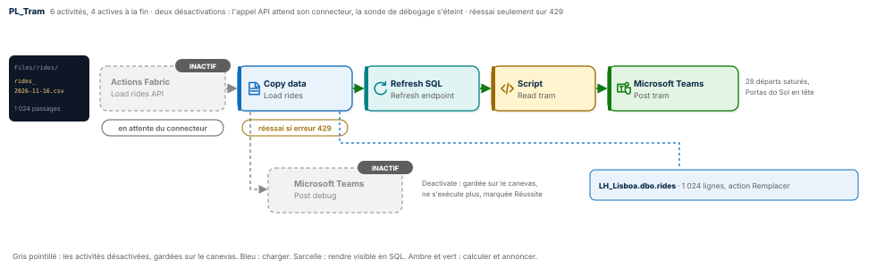
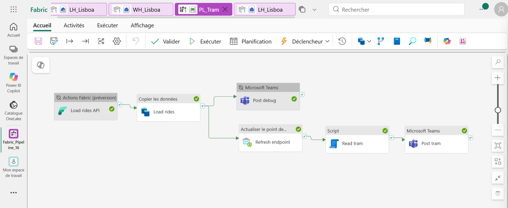
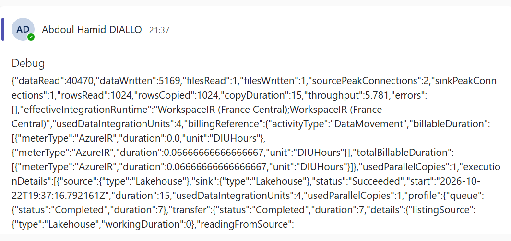
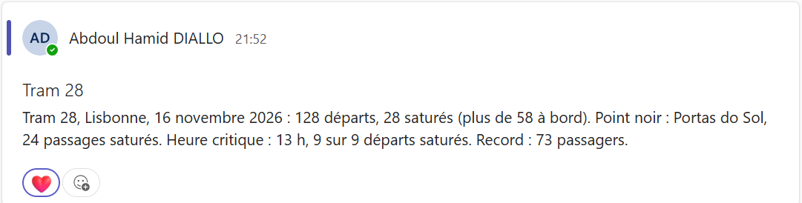
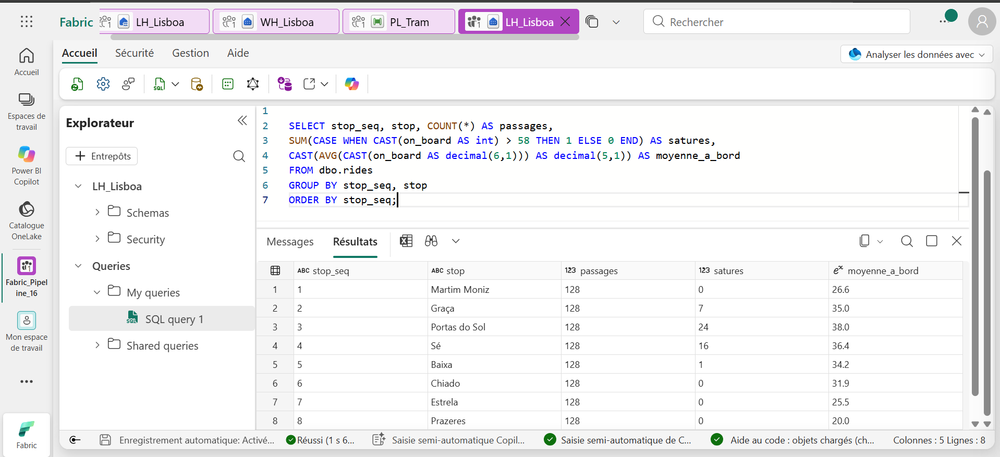
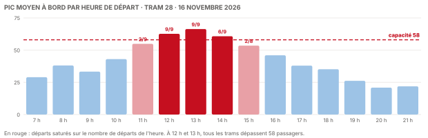

# 🚋 Fabric Pipeline Express 16 : le pipeline qui sait attendre




Un pipeline Microsoft Fabric Data Factory qui analyse une journée du tram 28 de Lisbonne, le 16 novembre 2026 : 128 départs, 1 024 passages, 58 places par tram. Il trouve le point noir de la ligne et l'heure critique, puis les annonce dans Teams. Au passage, il montre trois gestes de pro rarement expliqués : **mettre une activité en attente** sans casser le pipeline, **ne réessayer que lorsque cela a un sens**, et **déboguer avec une sonde qu'on éteint d'un clic**.

**Guide PDF de 7 pages inclus** : [`Pipeline_Fabric_Guide_16_public.pdf`](Pipeline_Fabric_Guide_16_public.pdf). Chaque écran, chaque réglage, chaque expression, et les chiffres à retrouver à l'unité près. Les valeurs à copier sont dans [`data/expressions.txt`](data/expressions.txt) et les requêtes commentées dans [`sql/`](sql).

## 📸 Aperçu

`PL_Tram` après l'exécution complète : `Load rides API` et `Post debug` sont désactivées (grises), les quatre activités du chemin principal sont vertes.



La sonde de débogage à l'exécution 1 : la sortie brute du chargement, publiée dans Teams. 1 024 lignes lues, 1 024 copiées, aucune erreur.



Le message final publié dans Microsoft Teams, construit entièrement en SQL.



La requête de contrôle sur le point de terminaison SQL du lakehouse : la charge arrêt par arrêt.



## 🎯 Résultats clés

| Indicateur | Valeur |
|---|---|
| Activités | 6 sur le canevas, 4 actives (Copy data, Refresh SQL analytics endpoint, Script, Microsoft Teams) |
| Nouveautés | Actions Fabric (préversion) mise en attente, désactivation d'activité avec « Marquer comme Réussite », conditions de nouvelle tentative sur le code 429, sonde de débogage |
| Passages | 1 024, sur 128 départs et 8 arrêts |
| Départs saturés | 28 sur 128, soit 21,9 %, au-dessus de 58 passagers |
| Point noir | Portas do Sol, 24 passages saturés, 38,0 passagers en moyenne |
| Heure critique | 13 h, 9 départs saturés sur 9, pic moyen de 66,4 passagers |
| Record de la journée | 73 passagers pour 58 places |

## 💼 Impact métier

Un exploitant de tramway ne manque pas de données, il manque de réponses : où et quand faut-il ajouter des voitures ? Ce pipeline répond en une phrase, chaque soir, dans le canal de l'équipe. Le matin et le soir, le tram 28 roule à moitié vide. Entre 12 h et 14 h, il déborde à Graça, Portas do Sol et Sé. C'est là, et seulement là, qu'il faut renforcer l'offre.

Côté ingénierie, le pipeline reste robuste et lisible. Une activité dont le connecteur n'est pas encore disponible reste sur le canevas sans bloquer la validation. Les réessais ne se déclenchent que sur une erreur passagère. La sonde de débogage reste prête à être rallumée.

## 📝 Résumé

`PL_Tram` commence par `Load rides API`, une activité **Actions Fabric** configurée sur l'opération **Load table** de l'API Lakehouse. Elle est désactivée et marquée **Réussite** : elle ne s'exécute pas, mais la flèche verte part d'elle. `Load rides`, un Copy data, charge alors le CSV dans la table `rides` de `LH_Lisboa`, avec deux réessais déclenchés uniquement sur le code d'erreur `429`. `Post debug` a publié la sortie brute du chargement pendant la mise au point, puis a été désactivée à son tour. `Refresh endpoint` rend la table visible en SQL, `Read tram` calcule les indicateurs et la phrase `msg` sur l'entrepôt `WH_Lisboa`, et `Post tram` l'annonce dans Teams.

## 🔁 Pipeline

| Activité | Type | État | Rôle |
|---|---|---|---|
| `Load rides API` | Actions Fabric (préversion) | Désactivée, marquée Réussite | L'appel API Load table, en attente de son connecteur |
| `Load rides` | Copy data | Active | Le CSV vers la table `rides`, action Remplacer, réessai sur 429 |
| `Post debug` | Microsoft Teams | Désactivée, marquée Réussite | La sonde : `@{string(activity('Load rides').output)}` |
| `Refresh endpoint` | Refresh SQL analytics endpoint | Active | Rend la table visible en SQL sans attente |
| `Read tram` | Script | Active | Les indicateurs du tram et la phrase `msg` |
| `Post tram` | Microsoft Teams | Active | Publie `@{activity('Read tram').output.resultSets[0].rows[0].msg}` |

## 🧠 Les quatre idées du projet

**Une activité en attente ne bloque rien.** Une activité désactivée n'est ni validée ni exécutée, mais elle garde sa place et ses liens. On peut préparer l'appel API de demain sans casser le pipeline d'aujourd'hui. Le jour où le connecteur arrive, on la rallume et on désactive le Copy data.

**« Marquer comme » décide de la suite.** Une activité désactivée marquée **Réussite** laisse partir la flèche verte. Marquée **Échec**, elle déclenche la flèche rouge. Marquée **Ignoré**, elle ne déclenche que la flèche « ignorée ». Ce simple choix fait d'une activité éteinte un aiguillage.

**Réessayer juste.** Par défaut, une activité réessaie sur n'importe quelle erreur. Avec une condition `Code d'erreur contient 429`, elle ne réessaie que sur « trop de requêtes, revenez plus tard ». Un chemin faux ou une table mal nommée échouera tout de suite, sans faire attendre le pipeline pour rien.

**Une sonde de débogage, comme un commentaire.** `Post debug` publie la sortie brute d'une activité pendant la mise au point, puis on l'éteint. Elle reste sur le canevas, prête à servir le jour où le chargement se comporte autrement.

## 🚦 Le pipeline en une image

| Étape | Au dépôt des trams | Dans Fabric |
|---|---|---|
| 1 | Les compteurs envoient la journée | CSV dans `Files/rides` |
| 2 | Le nouveau système de chargement est prêt, mais pas encore branché | Actions Fabric désactivée, marquée Réussite |
| 3 | L'ancien système charge, et réessaie si la ligne est occupée | Copy data, réessai sur 429 |
| 4 | Le technicien vérifie le chargement, puis débranche son testeur | Post debug, puis désactivée |
| 5 | L'analyste trouve le point noir et l'heure critique | Refresh endpoint, puis Script `Read tram` |
| 6 | L'équipe reçoit le bilan du soir | Teams `Post tram` |

## 🧬 Traçabilité

```
LH_Lisboa / Files / rides / rides_2026-11-16.csv        1 024 passages, 128 départs, 8 arrêts
                       │
Actions Fabric Load rides API      désactivée · marquée Réussite · opération Load table
                       │  flèche verte
                       ▼
Copy data Load rides (Remplacer)   réessai × 2 si code d'erreur contient 429
       │                                   │
       ▼                                   ▼
Teams Post debug                   LH_Lisboa.dbo.rides   trip_id · departed_at · stop_seq · stop · on_board
désactivée après l'exécution 1             │  Refresh SQL analytics endpoint Refresh endpoint
                                           ▼
                                   Script Read tram sur WH_Lisboa
                                      trips 128 · full_trips 28 · max_on_board 73
                                      worst_stop Portas do Sol · 24 · peak_hour 13 · 9 sur 9 · msg
                                           ▼
                                   Microsoft Teams Post tram
```

## 🏗️ Architecture

| Objet Fabric | Type | Rôle |
|---|---|---|
| `LH_Lisboa` | Lakehouse (sans schémas) | Reçoit le CSV dans `Files/rides`, porte la table `rides` |
| `CN_Lakehouse` | Connexion Lakehouse | Compte d'organisation, utilisée par le rafraîchissement du point de terminaison |
| `WH_Lisboa` | Entrepôt | Exécute `Read tram`, lit le lakehouse par un nom en trois parties |
| `PL_Tram` | Pipeline | Orchestre l'attente, le chargement, la sonde, le calcul et l'annonce |

Le cœur du calcul, dans `Read tram` : quatre étapes enchaînées, une seule ligne de résultat.

```sql
tr AS (SELECT trip, MIN(t) AS t, MAX(ob) AS peak FROM r GROUP BY trip),          -- le pic de chaque départ
s  AS (SELECT stop, SUM(CASE WHEN ob > 58 THEN 1 ELSE 0 END) AS sat, ...),      -- les saturations par arrêt
h  AS (SELECT DATEPART(hour, t) AS hr, ..., AVG(CAST(peak AS decimal(6,1)))),   -- le pic moyen par heure
k  AS (SELECT (SELECT COUNT(*) FROM tr) AS trips, ...)                          -- une ligne de chiffres
SELECT *, CONCAT('Tram 28, Lisbonne, ...', trips, ...) AS msg FROM k;           -- la phrase pour Teams
```

Le corps de l'appel API, prêt pour le jour où le connecteur sera disponible : [`data/load_body.json`](data/load_body.json).

## 📊 Résultat final



| N° | Arrêt | Passages saturés | Moyenne à bord |
|---|---|---|---|
| 1 | Martim Moniz | 0 | 26,6 |
| 2 | Graça | 7 | 35,0 |
| 3 | **Portas do Sol** | **24** | **38,0** |
| 4 | Sé | 16 | 36,4 |
| 5 | Baixa | 1 | 34,2 |
| 6 | Chiado | 0 | 31,9 |
| 7 | Estrela | 0 | 25,5 |
| 8 | Prazeres | 0 | 20,0 |

À 12 h comme à 13 h, les 9 départs dépassent 58 passagers. À 20 h, le pic moyen tombe à 20,9.

## 📦 Jeu de données

```
data/
├── rides/
│   └── rides_2026-11-16.csv    1 024 passages du tram 28, lundi 16 novembre 2026
├── load_body.json              le corps de l'appel API Load table
└── expressions.txt             toutes les valeurs du guide, prêtes à copier
```

Chaque ligne porte `trip_id` (le départ), `departed_at` (l'heure de départ du terminus), `stop_seq` et `stop` (l'arrêt, de 1 à 8), et `on_board` (les passagers à bord en quittant l'arrêt). Passages et charges sont fictifs, fixés pour l'exercice et reproductibles avec [`tools/generate_rides.py`](tools/generate_rides.py) ; [`tools/expected_results.py`](tools/expected_results.py) recalcule les résultats attendus. La capacité de 58 passagers est retenue pour l'exercice.

## 🚀 Reproduire l'exercice

1. Créer un lakehouse `LH_Lisboa` **sans** la case Schémas, un dossier `Files/rides`, y déposer le CSV. Créer un entrepôt `WH_Lisboa`.
2. Dans `PL_Tram`, ajouter une activité Actions Fabric `Load rides API` (Lakehouse, Load table), puis la **désactiver** et la **marquer Réussite**.
3. Relier un Copy data `Load rides` vers la table `rides` (Remplacer), avec 2 réessais et la condition `Code d'erreur contient 429`. Relier Teams `Post debug` avec `@{string(activity('Load rides').output)}` et exécuter une première fois.
4. Ajouter Refresh SQL analytics endpoint `Refresh endpoint`, le Script `Read tram` avec [`sql/01_read_tram.sql`](sql/01_read_tram.sql), puis Teams `Post tram` avec `@{activity('Read tram').output.resultSets[0].rows[0].msg}`.
5. Désactiver `Post debug` (marquée Réussite) et exécuter : 28 départs saturés, Portas do Sol en tête. Vérifier avec [`sql/02_controle.sql`](sql/02_controle.sql).

## 📂 Structure du dépôt

```
fabric-pipeline-express-16/
├── README.md
├── Pipeline_Fabric_Guide_16_public.pdf    le guide de 7 pages
├── data/
│   ├── rides/                             les passages du tram 28
│   ├── load_body.json                     le corps de l'appel API
│   └── expressions.txt                    toutes les valeurs à copier
├── sql/
│   ├── 01_read_tram.sql                   les indicateurs et le message Teams
│   └── 02_controle.sql                    la charge arrêt par arrêt
├── tools/
│   ├── generate_rides.py                  régénère le CSV
│   └── expected_results.py                recalcule les résultats attendus
└── images/
    ├── pipeline_diagram.svg               le schéma du pipeline
    ├── load_by_hour.svg                   le pic moyen par heure
    ├── pipeline_run.png                   PL_Tram après l'exécution complète
    ├── teams_debug.png                    la sonde de débogage dans Teams
    ├── teams_message.png                  le bilan du tram dans Teams
    └── controle_sql.png                   la requête de contrôle
```

## 🧰 Stack technique

Microsoft Fabric Data Factory · Actions Fabric (préversion) · API Lakehouse Load table · Désactivation d'activité · Conditions de nouvelle tentative · Copy data · Refresh SQL analytics endpoint · Script T-SQL · Warehouse · Lakehouse et Delta · Microsoft Teams

## ✅ Conclusion

Un pipeline professionnel ne se juge pas seulement à ce qu'il exécute, mais à la façon dont il gère ce qu'il ne doit pas encore exécuter. Celui-ci garde une activité en attente de son connecteur, ne réessaie que sur une erreur passagère, garde sa sonde de débogage éteinte mais prête, et livre chaque soir une réponse claire : le tram 28 déborde à Portas do Sol, entre 12 h et 14 h.

## 💭 Dernier mot

Savoir éteindre une activité sans la supprimer, c'est construire le pipeline de demain sans casser celui d'aujourd'hui.

---

Abdoul Hamid Diallo · Microsoft Data & AI Engineer · Microsoft Certified DP-600, DP-700, PL-300, AI-102, DP-100, AI-900, DP-900 · [LinkedIn](https://www.linkedin.com/in/abdoul-hamid-diallo-fabric-data-engineer/)
